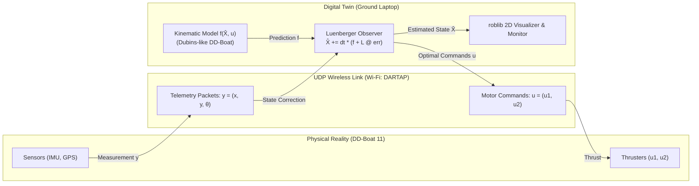
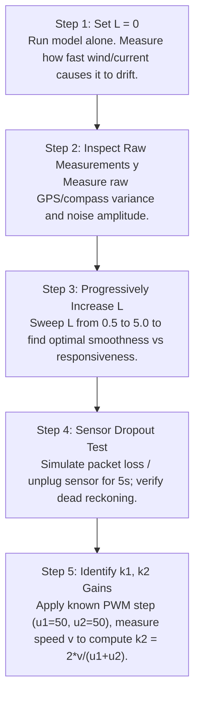

# DD-BOAT 11: DIGITAL TWIN, UDP COMMUNICATION & LUENBERGER OBSERVER
**BEST 2026 — ROBOTson Crusoe: Let's explore the lost city**  
*Guerlédan Lake, Brittany | ENSTA Bretagne · Lab-STICC · ROBEX*  
**Curriculum Module:** Digital Twins (Thursday, October 22, 2026)  
**Instructor:** Antoine Morvan (ENSTA)  
**Target Vessel:** DD-Boat 11 (`172.20.25.211`) · **Team:** NavySeals  
**Primary Source:** [`digital_twin_presentation.pdf`](file:///d:/Personal_Projects/BEST_Breast/digital_twin_presentation.pdf)

---

## 1. Executive Summary & Core Concepts

A **Digital Twin** is a dynamic virtual representation of a physical asset (here, DD-Boat 11) that maintains continuous, synchronized bi-directional communication with the real system.



### The Three Levels of Virtual Representation

| Level | Data Flow | Definition & Marine Robotics Example |
| :--- | :---: | :--- |
| **Digital Model** | None | Standalone offline simulation running on a laptop (`simu.py`, `single_boat_simulator.py`). Operates entirely independent of whether the real boat is turned on. |
| **Digital Shadow** | Real $\to$ Virtual | One-way telemetry feed. The virtual boat passively mirrors the real boat's logged GPS and IMU poses (`gps_logger.py`, Google Earth KML replay). |
| **Digital Twin** | **Real $\longleftrightarrow$ Virtual** | **Full bi-directional link.** The simulation receives live measurements, executes state estimation (Luenberger observer), predicts future states, and can send control commands back to the boat in real time. |

### Why Use a Digital Twin in Field Marine Robotics?
1. **Safety:** Test risky manoeuvres (sharp high-speed turns, obstacle clearance) virtually before committing thrusters.
2. **State Estimation / Observation:** Estimate quantities that sensors cannot measure directly or measure cleanly (filtered heading, filtered velocity, dead reckoning during GPS loss).
3. **Sensor-Model Fusion:** The model alone drifts; sensors alone are noisy and drop packets. The twin fuses both into a single robust state estimate.
4. **Fast Prototyping:** Run and optimize navigation plans in seconds before running them on water.

---

## 2. Mathematical Modeling: From Dubins Car to DD-Boat

### 2.1 The Classic Dubins Car (1957)
The Dubins car is the canonical model for non-holonomic vehicles that only drive forward and cannot turn on the spot:
* State: $X = (x, y, \theta)^\top \in \mathbb{R}^3$ (Cartesian coordinates and heading).
* Control: Steering rate $u \in [-u_{\max}, u_{\max}]$.
* Continuous equations:
  $$\begin{cases} \dot{x} = v \cos\theta \\ \dot{y} = v \sin\theta \\ \dot{\theta} = u \end{cases}$$
* Key property: The shortest path between any two configurations $(x_1, y_1, \theta_1)$ and $(x_2, y_2, \theta_2)$ is composed purely of straight-line segments and circular arcs at maximum curvature (LSL, RSR, LSR, RSL, etc.).

### 2.2 DD-Boat Kinematic Model (Dual Thrusters)
The DD-Boat is actuated by two submerged brushless thrusters: $u_1$ (left motor PWM) and $u_2$ (right motor PWM).

$$\begin{cases} \dot{x} = v \cos\theta \\ \dot{y} = v \sin\theta \\ \dot{\theta} = \omega \end{cases} \quad\text{with}\quad \begin{cases} v = k_2 \dfrac{u_1 + u_2}{2} \\ \omega = k_1 (u_2 - u_1) \end{cases}$$

Where:
* $v$: Forward linear velocity (proportional to the average thrust $\frac{u_1 + u_2}{2}$).
* $\omega$: Angular yaw rate (proportional to the differential thrust $u_2 - u_1$).
* $k_1, k_2$: Hydrodynamic gains identified through calibration trials on the real vessel:
  * $k_1$ has units $\text{rad}/(\text{s} \cdot \text{PWM unit})$ (turning responsiveness).
  * $k_2$ has units $\text{m}/(\text{s} \cdot \text{PWM unit})$ (propulsive speed coefficient).

### 2.3 Discrete Euler Integration
Continuous physical equations cannot be integrated analytically in real-time embedded loops, so we discretize using forward Euler integration with step $dt = 0.05\text{ s}$ ($20\text{ Hz}$):

$$\begin{cases} 
x_{k+1} = x_k + dt \cdot v \cos\theta_k \\
y_{k+1} = y_k + dt \cdot v \sin\theta_k \\
\theta_{k+1} = \theta_k + dt \cdot \omega 
\end{cases}$$

In vector notation:
$$X_{k+1} = X_k + dt \cdot f(X_k, u_k)$$

---

## 3. Communication Protocol: UDP Over Wi-Fi

The data link between DD-Boat 11 (`172.20.25.211`) and the ground station laptop (`172.20.26.64` on SSID `DARTAP`) uses **UDP (User Datagram Protocol)**.

### Why UDP Instead of TCP for Autonomous Robotics?

| Feature | UDP (User Datagram Protocol) | TCP (Transmission Control Protocol) |
| :--- | :--- | :--- |
| **Analogy** | Postcard | Registered letter with signature |
| **Delivery Guarantee** | No (packet may be lost) | Yes (retransmits until acknowledged) |
| **Connection Overhead**| Zero (connectionless datagrams) | 3-way handshake, continuous keep-alive |
| **Latency / Jitter** | **Ultra-low (immediate transmission)** | Higher (retransmission stalls queue) |
| **Suitability** | **Real-time robot control & telemetry** | Web browsing, file transfer, SSH |

> [!IMPORTANT]
> **Core Principle:** *"In mobile robotics, an old command is useless: we prefer fresh data to complete data."*  
> If an NMEA sentence or motor command packet is dropped due to lake spray or RF reflection, TCP stalls the entire pipeline trying to retransmit stale historical data. UDP simply moves on to the latest state.

### UDP Network Implementation Pattern (Python)
```python
import socket

# Configuration
BOAT_IP = "172.20.25.211"
PORT = 5005

# Create UDP socket
sock = socket.socket(socket.AF_INET, socket.SOCK_DGRAM)
sock.settimeout(0.1)  # Non-blocking: never hang the control loop

# 1. Transmit control command (u1, u2) as raw bytes
command_bytes = b"0.5,0.3"
sock.sendto(command_bytes, (BOAT_IP, PORT))

# 2. Receive telemetry measurement with timeout handling
try:
    data, addr = sock.recvfrom(1024)
    measurement_str = data.decode("utf-8")
    # Parse telemetry e.g. "x,y,theta"
except socket.timeout:
    # Essential for safety: code must survive dropped packets!
    pass
```

---

## 4. The Non-Linear Luenberger Observer

### 4.1 The Fundamental Engineering Dilemma
When operating DD-Boat 11 on Guerlédan Lake:
1. **The Model Alone Drifts:** External disturbances (wind blowing on hull, underwater currents, asymmetric propeller cavitation, unmodeled friction, approximate $k_1, k_2$) cause the pure open-loop model to deviate steadily from ground truth.
2. **Sensors Alone are Flawed:** GPS signals have multipath noise ($\pm 1-3\text{ m}$), magnetometers experience local magnetic anomalies, and Wi-Fi packets intermittently drop.

The solution is an **Observer**, which mathematically fuses the kinematic prediction of the model with the noisy measurements of the sensors.

### 4.2 Observer Equations
The classical Luenberger observer structure extended to our non-linear boat model:

$$\dot{\hat{X}} = \underbrace{f(\hat{X}, u)}_{\text{Model Prediction}} + \underbrace{L \cdot (y - \hat{y})}_{\text{Sensor Innovation / Correction}}, \quad \hat{y} = C \hat{X}$$

Where:
* $\hat{X} = [\hat{x}, \hat{y}, \hat{\theta}]^\top$: The observer's estimated state.
* $u = [u_1, u_2]^\top$: Motor commands currently applied.
* $y = [x_{\text{meas}}, y_{\text{meas}}, \theta_{\text{meas}}]^\top$: Sensor measurements from GPS and calibrated compass.
* $C = I_{3 \times 3}$: State observation matrix (full state is measured).
* $\hat{y} = C \hat{X} = \hat{X}$: Predicted sensor observation.
* $y - \hat{y} = \text{err}$: Measurement innovation (error between reality and prediction).
* $L = \text{diag}(l_1, l_1, l_2)$: Diagonal observer gain matrix.

### 4.3 Tuning Gain $L$ (The "Trust Dial")
The observer gain $L$ acts as a continuous dial between trusting the mathematical model vs trusting the physical sensors:

```
L = 0 -------------------------- L = Optimal --------------------------> L >> 1
Trust ONLY the Model           Balanced Luenberger Observer             Trust ONLY the Sensors
- Completely immune to noise    - Smooth, noise-rejected trajectory     - Fast tracking response
- Drifts away over time         - Zero long-term drift                   - Extremely noisy & jittery
- No sensor correction          - Fills gaps during packet loss         - Fails when packets drop
```

* **Small $L$ ($l_i \to 0$):** Heavy filtering; state is smooth but vulnerable to dead reckoning drift.
* **Large $L$ ($l_i \gg 1$):** High responsiveness; fast convergence to measurements, but passes sensor noise directly into the state.
* **Baseline Recommendation:** $L = \text{diag}([2.0, 2.0, 2.0])$.

### 4.4 Angular Error Normalization ($\text{sawtooth}$)
Because heading $\theta$ is cyclical ($-\pi$ to $\pi$ or $0$ to $2\pi$), the innovation error $\text{err}[2] = y[2] - \hat{X}[2]$ must be wrapped:
$$\text{err}[2] = \text{sawtooth}(\text{err}[2]) = (\text{err}[2] + \pi \pmod{2\pi}) - \pi \in [-\pi, \pi]$$
Without this normalization, an angle transition across the branch cut (e.g. from $179^\circ$ to $-179^\circ$) generates an erroneous $358^\circ$ step change, destabilizing the observer.

### 4.5 Robust Handling of Packet Dropouts
When a UDP telemetry packet is lost (`socket.timeout` triggered):
$$\text{err} = \begin{bmatrix} 0 \\ 0 \\ 0 \end{bmatrix} \implies \hat{X}_{k+1} = \hat{X}_k + dt \cdot f(\hat{X}_k, u_k)$$
The observer smoothly falls back to pure model dead-reckoning without halting or throwing an exception!

---

## 5. Practical Session Curriculum & Exercises

### Part 1: Official Page 13 & 14 Simulation Runner
All exercises from Pages 13 and 14 are consolidated into [`simu_page13.py`](file:///d:/Personal_Projects/BEST_Breast/simu_page13.py) with interactive and command-line execution:
* **Run Base Slide 13:** `python simu_page13.py 0` ($u_1=1.0, u_2=0.8 \implies$ Clockwise arc, $R=4.5\text{ m}$)
* **Run Exercise 1:** `python simu_page13.py 1` ($u_1=u_2=1.0 \implies$ Straight line)
* **Run Exercise 2:** `python simu_page13.py 2` ($u_1<u_2$ Left turn $\to$ $u_1>u_2$ Right turn)
* **Run Exercise 3:** `python simu_page13.py 3` ($u_1=-u_2 \implies$ Zero translation, in-place spin)
* **Run Exercise 4:** `python simu_page13.py 4` (Square trajectory, 4 sides of $4.0\text{ m}$ + four $90^\circ$ turns, loop closure error $<10^{-13}\text{ m}$)
* **Run All Sequentially:** `python simu_page13.py all`

The multi-panel publication plot is generated by [`digital_twin_exercises.py`](file:///d:/Personal_Projects/BEST_Breast/digital_twin_exercises.py), and the complete analysis is in [`digital_twin_exercises_report.md`](file:///C:/Users/vamsh/.gemini/antigravity/brain/8b36c553-4636-46d5-8617-b9ca4e43c788/digital_twin_exercises_report.md).

### Part 2: In-Water Verification on DD-Boat 11
Follow Antoine Morvan's 5 validation steps on Guerlédan Lake:



---

## 6. Complete Python Implementation Template

### 6.1 Digital Twin Observer Script (`digital_twin_observer.py`)
```python
import socket
import time
import numpy as np

# Network configuration
BOAT_IP = "172.20.25.211"
COMMAND_PORT = 5005
TELEMETRY_PORT = 5006

# Model parameters (identified on boat)
k1 = 1.0  # Yaw rate gain
k2 = 1.0  # Linear speed gain
dt = 0.05

def f(x, u):
    """
    DD-Boat kinematic dynamic model
    x = [x_pos, y_pos, theta]
    u = [u_left, u_right]
    """
    v = k2 * (u[0] + u[1]) / 2.0
    w = k1 * (u[1] - u[0])
    return np.array([v * np.cos(x[2]), v * np.sin(x[2]), w])

def sawtooth(angle):
    """Wraps angle into [-pi, pi]"""
    return (angle + np.pi) % (2.0 * np.pi) - np.pi

# Sockets
sock_cmd = socket.socket(socket.AF_INET, socket.SOCK_DGRAM)
sock_tel = socket.socket(socket.AF_INET, socket.SOCK_DGRAM)
sock_tel.bind(("0.0.0.0", TELEMETRY_PORT))
sock_tel.settimeout(0.1)

# Luenberger observer gains
L = np.diag([2.0, 2.0, 2.0])
xhat = np.array([0.0, 0.0, 0.0])  # State estimate [x, y, theta]

print("Digital Twin Observer running. Fusing model and UDP telemetry...")

u = np.array([50.0, 50.0])  # Desired thruster commands

try:
    while True:
        # 1. Send command to physical boat
        cmd_bytes = "{:.1f},{:.1f}".format(u[0], u[1]).encode("utf-8")
        sock_cmd.sendto(cmd_bytes, (BOAT_IP, COMMAND_PORT))

        # 2. Receive telemetry measurement
        try:
            data, _ = sock_tel.recvfrom(1024)
            parts = [float(val) for val in data.decode("utf-8").strip().split(",")]
            y = np.array(parts[:3])  # [x_meas, y_meas, theta_meas]
            
            # Innovation error
            err = y - xhat
            err[2] = sawtooth(err[2])
        except socket.timeout:
            # Fallback on model alone during packet loss
            err = np.zeros(3)

        # 3. Luenberger Observer update step
        xhat = xhat + dt * (f(xhat, u) + L @ err)
        xhat[2] = sawtooth(xhat[2])

        time.sleep(dt)

except KeyboardInterrupt:
    sock_cmd.sendto(b"0,0", (BOAT_IP, COMMAND_PORT))
    print("\nDigital Twin stopped cleanly. Motors disarmed.")
```

---

## 7. Relation to Regatta & Advanced Filtering
* **Kalman Filter Generalization:** The Luenberger observer gain matrix $L$ is fixed (static). The Kalman Filter (EKF) generalizes this by computing the optimal time-varying gain $K_k = P_k C^\top (C P_k C^\top + R)^{-1}$ using process noise covariance $Q$ and measurement noise covariance $R$.
* **Regatta Advantage:** On Friday's regatta race, GPS multipath around shoreline trees and buoy interference can distort raw positions. Running the digital twin observer on Boat 11 filters out position spikes, ensuring smooth line-following and precise gate crossings.
